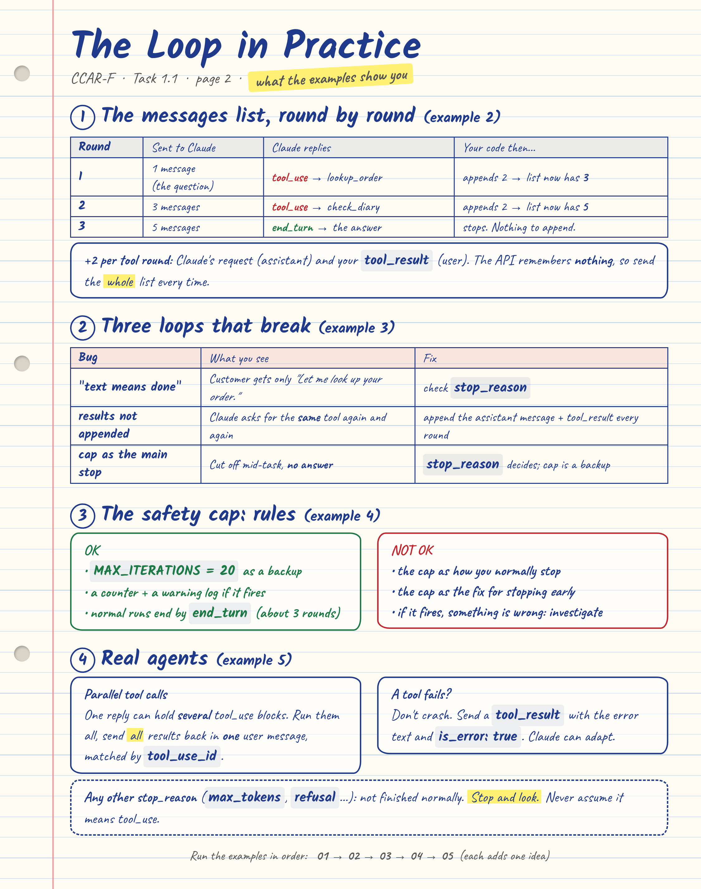

# 1.1 The Agentic Loop (CCAR-F, Domain 1)

> **In one line:** an agentic loop is a normal `for`/`while` loop in *your* code that keeps talking to Claude, runs the tools Claude asks for, and stops when Claude says it is finished.

**[Take the interactive quiz online](https://pranavdhopey.github.io/ccar-f-study-guide/1-agentic-architecture/1-1-agentic-loops/quiz.html)** (16 exam-style questions, opens in your browser)




---

## The idea in plain words (no jargon)

Imagine you run a pizza shop and you hire a very smart **manager** (Claude) who sits in a room with no phone and no computer.

- The manager can **think and talk**, but cannot **do** anything.
- So the manager writes a note: *"Please look up Sam's order."*
- **You** (your code) read the note, go and look it up, and slide the answer back under the door.
- The manager reads it and either writes another note ("now multiply by 3") or says *"All done, here is your answer."*

That back-and-forth is the **agentic loop**.

| Pizza shop | Real world |
|---|---|
| Manager in the room | Claude |
| "Please look up Sam's order" note | a `tool_use` request |
| You doing the errand | your code running the tool |
| Answer slid under the door | a `tool_result` message |
| "All done!" | `stop_reason = "end_turn"` |

> **Claude never runs a tool. It only asks.** Your code runs it.

**Agent = Claude + Tools + Loop code.**

---

## The 4 steps

```
        +----------------------+
        |  1. SEND request     |  <-- full history + tool list
        +----------+-----------+
                   |
                   v
        +----------------------+
        |  2. CHECK stop_reason|
        +----+------------+----+
   "tool_use"|            |"end_turn"
             v            v
  +-------------------+  +-----------------+
  | 3. RUN the tool,  |  | 4. DONE         |
  |    append result  |  | show the answer |
  |    to history     |  +-----------------+
  +---------+---------+
            |
            +----> back to step 1
```

| `stop_reason` | Meaning | Your loop should |
|---|---|---|
| `tool_use` | Claude wants a tool | run it, append the result, **keep going** |
| `end_turn` | Claude is finished | **stop** and show the answer |

**Easy memory trick:** `tool_use` = *"keep cooking"*, `end_turn` = *"dinner's served"*.

### Why step 3 is where loops break
The Messages API **remembers nothing** between calls. If you forget to append the tool result to the conversation, Claude never sees what the tool returned and has nothing new to think about.

---

## The golden rule

**`stop_reason` is the only reliable signal for loop control.**

### 3 anti-patterns (do NOT use these as your main stop signal)

| # | Anti-pattern | Why it fails |
|---|---|---|
| 1 | Parse Claude's words ("I'm done", "task complete") | Language is vague. "I finished file 1" might mean "file 2 is next". |
| 2 | Stop after N loops (e.g. 10) | Cuts off real work, or wastes loops when it finished early. |
| 3 | Treat "first block is text" as finished (`content[0].type == "text"`) | Claude often sends text **and** a tool call in the same reply. |

> A **safety cap** (e.g. 20) is fine as a backup against runaway loops. It must never be the *primary* way the loop stops, and it is **not** the fix for stopping too early.

---

## Who picks the tool?

- **Model-driven (default):** Claude reads the task and chooses tools. Flexible, handles surprises.
- **Fixed decision tree:** you hard-code the order. Use only where rules **must** be followed (money, security, regulations). That is Task 1.4.

---

## Try it yourself: five examples, in order

Each example adds **one** idea. Run them from the repo root, in order.

```bash
pip install anthropic
export ANTHROPIC_API_KEY="your-key"      # never commit your key
cd 1-agentic-architecture/1-1-agentic-loops/examples
```

| # | Run | What it adds |
|---|---|---|
| 1 | `python 01_minimal_loop.py` | The bare loop: send, check `stop_reason`, run tools, append, repeat |
| 2 | `python 02_watch_the_history.py` | Prints the messages list after every round so you **see** the history grow |
| 3 | `python 03_break_it.py` | Three deliberately broken loops, then the fixed one, on the same question |
| 4 | `python 04_build_exercise.py` | The guide's Build Exercise, with the safety cap and warning log |
| 5 | `python 05_cloud_ops_agent.py` | A realistic agent: parallel tool calls and tool errors |

### Example 1: the minimal loop

Claude is asked *"How much do 3 pizzas cost?"* and has two tools, `get_price` and `multiply`. You should see something like this (Claude may skip `multiply` and do the sum itself, or word the last line differently):

```
stop_reason: tool_use
  ran get_price({'item': 'pizza'}) -> 12
stop_reason: tool_use
  ran multiply({'a': 12, 'b': 3}) -> 36
stop_reason: end_turn
3 pizzas cost $36.
```

Notice that Claude never calls `get_price` itself. It **asks**, and `run_tool()` in your code does the work. Any `stop_reason` other than `tool_use` and `end_turn` raises an error instead of being guessed at.

### Example 2: watch the history grow

A glazier's support agent must `lookup_order` (which returns a `fitter_id`), then `check_diary` (which needs that `fitter_id`). The second call depends on the first, so Claude cannot do them at once. The output looks like this (Claude's wording will differ, the message counts will not):

```
=== Round 1: sending 1 message(s) ===
stop_reason: tool_use
  --- history sent next: 3 message(s) ---
  [0] user      text: "Hi, it's Priya. When is the fitting for order W-1042?"
  [1] assistant text: "Let me look up your order."  +  tool_use: lookup_order({'order_id': 'W-1042'})
  [2] user      tool_result: {'customer': 'Priya', 'item': 'double-glazed window', 'fitter_id': 'F-7'}

=== Round 2: sending 3 message(s) ===
stop_reason: tool_use
  --- history sent next: 5 message(s) ---
  ...
  [3] assistant text: "Now checking the fitter's diary."  +  tool_use: check_diary({'fitter_id': 'F-7'})
  [4] user      tool_result: {'fitter_id': 'F-7', 'next_free_slot': 'Tuesday 4 Nov, 9:00'}

=== Round 3: sending 5 message(s) ===
stop_reason: end_turn

Final answer: Your fitting is on Tuesday 4 Nov at 9:00.
```

The list grows by **2 per tool round** (Claude's request, then your `tool_result`), and the whole list is sent every time because the API remembers nothing.

### Example 3: break the loop on purpose

Same glazier question, four loops. Run one at a time with `python 03_break_it.py text`, `noappend`, `cap` or `fixed`.

| Loop | What you should see | Why |
|---|---|---|
| `text` | The customer gets only *"Let me look up your order."* | It treats "first block is text" as finished (anti-pattern 3) |
| `noappend` | Claude asks for `lookup_order` again and again, then the demo gives up after 4 rounds | Tool results never reach Claude, so every round looks like round 1 |
| `cap` | No answer for the customer: *"cut off by the cap of 2"* | The task needs 3 rounds. A cap as the main stop cuts off real work (anti-pattern 2) |
| `fixed` | The correct answer after 3 rounds | `stop_reason` decides. The cap is only a backup |

The script's system prompt asks Claude to write a sentence before each tool call. That makes the `text` bug show up every time. Real Claude often does this on its own, which is why the bug appears only *sometimes* in production.

### Example 4: the Build Exercise

This follows the six steps of the exercise on the guide page, with `STEP 1` to `STEP 6` comments in the code. It uses a calculator and a web search stub, and a prompt where the search must come first: the shop, *Glasshouse Bakery*, is made up, so Claude cannot know its prices.

```bash
python 04_build_exercise.py                      # normal: about 3 rounds, nowhere near the cap
python 04_build_exercise.py --runaway --cap 5    # the search never finds anything
```

In the `--runaway` run you should see Claude keep searching until the cap fires:

```
INFO: round 5: stop_reason=tool_use
WARNING: Hit MAX_ITERATIONS (5). The agent may be stuck in a runaway loop. Investigate.
```

Claude may give up and answer before round 5. That is also fine: it ends through `end_turn`, not the cap.

### Example 5: a realistic agent

Find idle VMs in a (made-up) project and estimate the monthly saving, using `list_instances`, `get_monthly_cost` and `calculator`. Two things happen that did not in the earlier examples:
- **Parallel tool calls:** Claude may ask for several VM prices in a single reply. The loop runs them all and sends **all** the `tool_result`s back in **one** user message, matched by `tool_use_id`.
- **Tool errors:** one VM has a machine type with no price, so `get_monthly_cost` raises `KeyError`. The loop sends the error back as a `tool_result` with `is_error: true`, and Claude should say which VM it could not price instead of the loop crashing.

The data and prices are made up.

### Does this cover the guide's Build Exercise?

The five "What you'll learn" points on the guide page:

| What you'll learn | Where to see it |
|---|---|
| How the agentic loop lifecycle works with the Messages API | Example 1 (the loop), notes page 1 |
| Why `stop_reason` is the authoritative signal for loop control | Example 3 (three loops fail when it is ignored) |
| How to handle `tool_use` and `end_turn` values correctly | Examples 1 and 4; any other value is not guessed at |
| How to append tool results to history for multi-turn execution | Example 2 (printed history), Example 3 `noappend` |
| When safety iteration caps are appropriate versus inappropriate | Example 3 `cap` (inappropriate), Example 4 (appropriate, and the `--runaway` demo) |

The six steps of the exercise, all in `examples/04_build_exercise.py`:

| Exercise step | In the code |
|---|---|
| 1. Two tools (calculator, web search stub) with JSON Schema `input_schema` | `# STEP 1`, the `tools` list |
| 2. Loop that calls `client.messages.create()` and checks `stop_reason` | `# STEP 2`, the `while` loop |
| 3. On `tool_use`: run the tool, append the assistant reply and a user `tool_result` message | `# STEP 3` |
| 4. On `end_turn`: return the final text | `# STEP 4` |
| 5. A prompt needing search, then calculate: at least 2 rounds before `end_turn` | `# STEP 5`, `PROMPT` |
| 6. Safety cap of 20, a counter, and a warning log if it triggers | `# STEP 6`, three places |

**How these were checked:** I ran every example against a stand-in for the API that enforces the Messages API's message rules (roles alternate, every `tool_use` gets a matching `tool_result`, no empty messages). That checks the loop code, not what real Claude decides, so wording and occasionally tool choices will differ when you run them with your own key.

### Challenges
1. In example 1, change `max_tokens=1024` to `max_tokens=5`. Claude's reply is cut off, `stop_reason` becomes `max_tokens`, and the loop raises an error instead of carrying on as if it were `tool_use`.
2. Run `python 04_build_exercise.py --cap 2`. Everything works, yet the cap fires because the task needs 3 rounds. This is why a cap can never be the primary stop.
3. In example 2, add a third tool `get_discount(item)` and ask a question that needs all three. How many messages are sent in the last round?
4. In example 5, make `get_monthly_cost` fail for every machine type. How does Claude's final answer change?

---

## Test yourself

16 exam-style questions on this topic (15 on the exam's keyed content and the examples, 1 bonus on `refusal`):

- **[Interactive quiz (live link)](https://pranavdhopey.github.io/ccar-f-study-guide/1-agentic-architecture/1-1-agentic-loops/quiz.html)**: pick an answer and it shows why it is right or wrong, with a running score. The source file is [`quiz.html`](quiz.html), a single file with no dependencies, so you can also download it and open it in a browser.
- **[`quiz.md`](quiz.md)** is the same questions with click-to-reveal answers. It works directly in GitHub's file preview.

Both are generated from `quiz.json`. To add or edit a question, change that file and run `python tools/build_quiz.py 1-agentic-architecture/1-1-agentic-loops` from the repo root.

---

## Beyond the exam: other stop reasons

The exam guide keys on `tool_use` and `end_turn`, but a production loop should handle the rest too:

| `stop_reason` | Meaning |
|---|---|
| `pause_turn` | A long-running server-tool turn paused; continue it |
| `max_tokens` | The reply was cut off |
| `stop_sequence` | Hit one of your stop strings |
| `refusal` | Claude declined to respond (a normal HTTP 200, not an error) |
| `model_context_window_exceeded` | Response filled the context window; treat like `max_tokens` |

Rule of thumb: anything that is **not** `end_turn` means "not finished, find out why". Don't assume it means `tool_use`.

---

## Exam cheat sheet

- Continue on `tool_use`, terminate on `end_turn`, reject all three anti-patterns.
- Iteration caps are a **safety net**, never the fix for premature exit.
- Always append tool results to history. Don't replace history with a summary to save tokens; shrink what the *tool returns* instead.
- Model-driven tool selection is the default; use programmatic enforcement only for must-comply business rules.

## Files in this folder

| File | What it is |
|---|---|
| `README.md` | This explanation |
| `notes.png`, `notes-2.png` | Handwritten-style notes. Page 1: the concepts. Page 2: the loop in practice |
| `notes.html`, `notes-2.html` | Sources for the notes images. Edit them, then run `python tools/render_notes.py 1-agentic-architecture/1-1-agentic-loops` from the repo root (needs `playwright`) |
| `examples/` | Five runnable examples, `01_minimal_loop.py` to `05_cloud_ops_agent.py` |
| `quiz.html` | Interactive practice questions (open in a browser) |
| `quiz.md` | The same questions with click-to-reveal answers (renders on GitHub) |
| `quiz.json` | Question source. `tools/build_quiz.py` turns it into the two quiz files |

## Sources
- [CCAR-F Guide: 1.1 Agentic Loops](https://claudecertificationguide.com/learn/1-agentic-architecture/1-1-agentic-loops)
- [Anthropic: Tool use overview](https://platform.claude.com/docs/en/agents-and-tools/tool-use/overview)
- [Anthropic: Messages API reference](https://platform.claude.com/docs/en/api/messages)

---

[Back to Domain 1](../README.md) &nbsp;|&nbsp; Next topic: [1.2 Multi-Agent Orchestration](../1-2-orchestration-patterns/)
