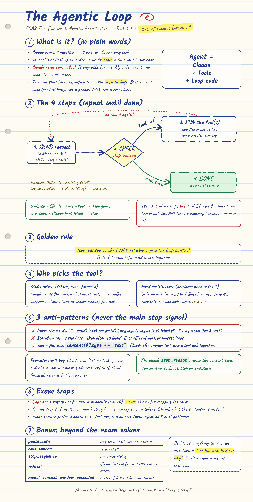

# 1.1 The Agentic Loop (CCAR-F, Domain 1)

> **In one line:** an agentic loop is a normal `for`/`while` loop in *your* code that keeps talking to Claude, runs the tools Claude asks for, and stops when Claude says it is finished.



---

## The idea in plain words (no jargon)

Imagine you run a pizza shop and you hire a very smart **manager** (Claude) who sits in a room with no phone and no computer.

- The manager can **think and talk**, but cannot **do** anything.
- So the manager writes a note: *"Please look up Sam's order."*
- **You** (your code) read the note, go and look it up, and slide the answer back under the door.
- The manager reads it and either writes another note ("now multiply by 3") or says *"All done, here is your answer."*

That back-and-forth is the **agentic loop**.

| Pizza shop | Real world |
|---|---|
| Manager in the room | Claude |
| "Please look up Sam's order" note | a `tool_use` request |
| You doing the errand | your code running the tool |
| Answer slid under the door | a `tool_result` message |
| "All done!" | `stop_reason = "end_turn"` |

> **Claude never runs a tool. It only asks.** Your code runs it.

**Agent = Claude + Tools + Loop code.**

---

## The 4 steps

```
        +----------------------+
        |  1. SEND request     |  <-- full history + tool list
        +----------+-----------+
                   |
                   v
        +----------------------+
        |  2. CHECK stop_reason|
        +----+------------+----+
   "tool_use"|            |"end_turn"
             v            v
  +-------------------+  +-----------------+
  | 3. RUN the tool,  |  | 4. DONE         |
  |    append result  |  | show the answer |
  |    to history     |  +-----------------+
  +---------+---------+
            |
            +----> back to step 1
```

| `stop_reason` | Meaning | Your loop should |
|---|---|---|
| `tool_use` | Claude wants a tool | run it, append the result, **keep going** |
| `end_turn` | Claude is finished | **stop** and show the answer |

**Easy memory trick:** `tool_use` = *"keep cooking"*, `end_turn` = *"dinner's served"*.

### Why step 3 is where loops break
The Messages API **remembers nothing** between calls. If you forget to append the tool result to the conversation, Claude never sees what the tool returned and has nothing new to think about.

---

## The golden rule

**`stop_reason` is the only reliable signal for loop control.**

### 3 anti-patterns (do NOT use these as your main stop signal)

| # | Anti-pattern | Why it fails |
|---|---|---|
| 1 | Parse Claude's words ("I'm done", "task complete") | Language is vague. "I finished file 1" might mean "file 2 is next". |
| 2 | Stop after N loops (e.g. 10) | Cuts off real work, or wastes loops when it finished early. |
| 3 | Treat "first block is text" as finished (`content[0].type == "text"`) | Claude often sends text **and** a tool call in the same reply. |

> A **safety cap** (e.g. 20) is fine as a backup against runaway loops. It must never be the *primary* way the loop stops, and it is **not** the fix for stopping too early.

---

## Who picks the tool?

- **Model-driven (default):** Claude reads the task and chooses tools. Flexible, handles surprises.
- **Fixed decision tree:** you hard-code the order. Use only where rules **must** be followed (money, security, regulations). That is Task 1.4.

---

## Try it yourself

The whole loop is about 40 lines in [`agentic_loop.py`](agentic_loop.py).

```bash
pip install anthropic
export ANTHROPIC_API_KEY="your-key"
python agentic_loop.py
```

Claude gets one question, *"How much do 3 pizzas cost?"*, and two tools: `get_price` and `multiply`. You should see something like this (Claude may phrase the last line differently):

```
stop_reason: tool_use
  ran get_price({'item': 'pizza'}) -> 12
stop_reason: tool_use
  ran multiply({'a': 12, 'b': 3}) -> 36
stop_reason: end_turn
3 pizzas cost $36.
```

What to notice:
- Claude never calls `get_price` itself. It **asks**, and `run_tool()` in your code does the work.
- The loop only stops when `stop_reason` is `end_turn`.
- Each round sends the **whole history** again, and it grows by 2 messages per tool round: Claude's request, then your tool result.

### Challenges
1. Delete the line that appends `results` to `messages`. What breaks, and why?
2. Add a third tool, `get_discount(item)`, and ask a question that needs all three tools.
3. Swap the `end_turn` check for `response.content[0].type == "text"`. Whenever Claude writes a sentence before its tool call, the loop now quits early. This is anti-pattern 3.
4. Replace `while True` with `for _ in range(20)` and log a warning if the loop runs out. That is the safety net from the exam: backup only, never the main stop signal.

---

## Test yourself

11 exam-style questions on this topic (10 on the exam's keyed content, 1 bonus on `refusal`):

- **[`quiz.html`](quiz.html)** is the interactive version: pick an answer and it shows why it is right or wrong, with a running score. It is a single file with no dependencies, so download it and open it in a browser, or serve it with GitHub Pages.
- **[`quiz.md`](quiz.md)** is the same questions with click-to-reveal answers. It works directly in GitHub's file preview.

Both are generated from `quiz.json`. To add or edit a question, change that file and run `python tools/build_quiz.py 1-agentic-architecture/1-1-agentic-loops` from the repo root.

---

## Beyond the exam: other stop reasons

The exam guide keys on `tool_use` and `end_turn`, but a production loop should handle the rest too:

| `stop_reason` | Meaning |
|---|---|
| `pause_turn` | A long-running server-tool turn paused; continue it |
| `max_tokens` | The reply was cut off |
| `stop_sequence` | Hit one of your stop strings |
| `refusal` | Claude declined to respond (a normal HTTP 200, not an error) |
| `model_context_window_exceeded` | Response filled the context window; treat like `max_tokens` |

Rule of thumb: anything that is **not** `end_turn` means "not finished, find out why". Don't assume it means `tool_use`.

---

## Exam cheat sheet

- Continue on `tool_use`, terminate on `end_turn`, reject all three anti-patterns.
- Iteration caps are a **safety net**, never the fix for premature exit.
- Always append tool results to history. Don't replace history with a summary to save tokens; shrink what the *tool returns* instead.
- Model-driven tool selection is the default; use programmatic enforcement only for must-comply business rules.

## Files in this folder

| File | What it is |
|---|---|
| `README.md` | This explanation |
| `notes.png` | The handwritten-style notes |
| `notes.html` | Source for the notes image. Edit it, then run `python tools/render_notes.py 1-agentic-architecture/1-1-agentic-loops` from the repo root (needs `playwright`) |
| `agentic_loop.py` | The whole loop in about 40 lines, using the real API |
| `quiz.html` | Interactive practice questions (open in a browser) |
| `quiz.md` | The same questions with click-to-reveal answers (renders on GitHub) |
| `quiz.json` | Question source. `tools/build_quiz.py` turns it into the two quiz files |

## Sources
- [CCAR-F Guide: 1.1 Agentic Loops](https://claudecertificationguide.com/learn/1-agentic-architecture/1-1-agentic-loops)
- [Anthropic: Tool use overview](https://platform.claude.com/docs/en/agents-and-tools/tool-use/overview)
- [Anthropic: Messages API reference](https://platform.claude.com/docs/en/api/messages)

---

[Back to Domain 1](../README.md) &nbsp;|&nbsp; Next topic: 1.2 Multi-Agent Orchestration (coming soon)
