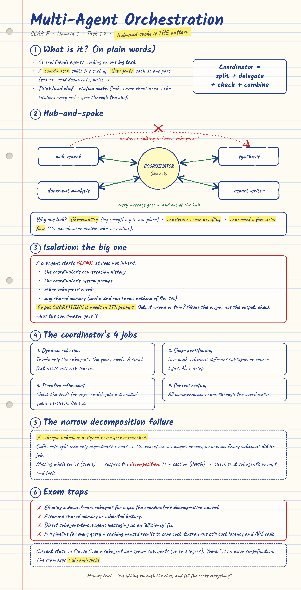
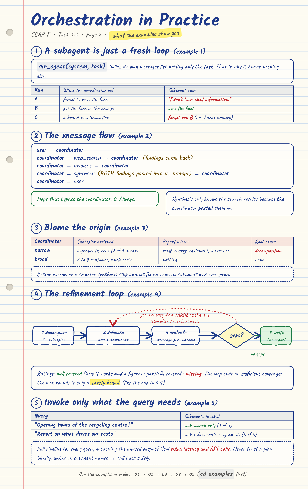

# 1.2 Multi-Agent Orchestration (CCAR-F, Domain 1)

> **In one line:** a **coordinator** splits a big task into parts, hands each part to a **subagent**, and combines the results. Every message goes **through** the coordinator, and every subagent must be **told everything it needs**, because it starts knowing nothing.

**[Take the interactive quiz online](https://pranavdhopey.github.io/ccar-f-study-guide/1-agentic-architecture/1-2-orchestration-patterns/quiz.html)** (16 exam-style questions, opens in your browser)





---

## The idea in plain words (no jargon)

Picture a restaurant kitchen. The **head chef** gets the order, decides which **station cooks** are needed, and tells each one exactly what to make. The cooks never shout across the kitchen at each other. Everything goes through the chef, who also checks the plate before it leaves.

| Kitchen | Real world |
|---|---|
| Head chef | The **coordinator** (the hub) |
| Station cooks | **Subagents** (the spokes): web search, document analysis, synthesis... |
| The chef's instructions to a cook | The subagent's **prompt**. It is all the cook knows |
| Cooks never talk to each other | **All communication routes through the coordinator** |
| Chef checks the plate, sends back for a missing side | The **iterative refinement loop** |

---

## Hub-and-spoke

```
                 web search  <---+
                                 |
 user  <-->  COORDINATOR  <------+-->  document analysis
                                 |
                 synthesis  <----+
```

The coordinator receives the task, splits it up, decides which subagents to use, passes them context, collects and combines the results, and handles errors. Subagents only talk to the coordinator.

**Why one hub?**
- **Observability:** every message can be logged and monitored in one place.
- **Consistent error handling:** the coordinator applies one recovery policy.
- **Controlled information flow:** the coordinator decides what each subagent sees.

---

## Isolation: the most misunderstood idea

A new subagent starts with **only what the coordinator puts in its prompt**. It does **not** get:
- the coordinator's conversation history,
- the coordinator's system prompt (unless you include it),
- other subagents' results (unless you pass them on),
- any shared memory. A second run of the same subagent knows nothing about the first.

So the coordinator must write **everything** the subagent needs into that subagent's prompt. If the web search results are needed for synthesis, the coordinator pastes them into the synthesis prompt.

In practice a subagent is just the loop from [topic 1.1](../1-1-agentic-loops/) called with **its own fresh messages list** that holds only the task. That is why it can't know anything else, and `examples/agent_kit.py` shows it in a few lines.

> **Blame the origin, not the output.** When a subagent's output is incomplete or wrong, first check whether the coordinator gave it the right input.

---

## The coordinator's four jobs

| Job | What it means | Example |
|---|---|---|
| **Dynamic subagent selection** | Invoke only the subagents the query needs | A simple factual question needs only web search |
| **Research scope partitioning** | Give each subagent distinct subtopics or source types so none overlap | One searches the web, another reads internal documents |
| **Iterative refinement** | Check the draft for gaps, re-delegate a *targeted* query, re-check | Draft has no insurance section, so search for insurance costs and synthesise again |
| **Centralised routing** | All communication goes through the coordinator | Web search findings go back to the coordinator, never straight to synthesis |

---

## The narrow decomposition failure

**A subtopic nobody is assigned never gets researched.**

A coordinator splits "what drives our café's costs?" into only *ingredients* and *rent*. Every subagent does its job perfectly, but the report has nothing on wages, energy or insurance.

| Symptom | Suspect first |
|---|---|
| Whole topics are **missing** (scope) | The coordinator's **decomposition** |
| A topic is there but **thin** (depth) | That subagent's prompt, tools and context |

Better search queries, a cleverer synthesis step or more subagents with equally narrow assignments would not fix a gap in the decomposition.

---

## Exam traps

1. **Blaming a downstream subagent** for a coverage gap that the coordinator's decomposition caused.
2. **Assuming shared memory or inherited history.** Pass everything explicitly.
3. **Direct subagent-to-subagent communication as an "efficiency" fix.** It bypasses observability, consistent error handling and controlled information flow.
4. **Running every query through the full pipeline and caching unused results to save cost.** Unneeded subagents still add latency and API overhead. Invoke only what each query needs.

**Current state (per the guide, checked 6 October 2026):** in Claude Code a subagent *can* spawn subagents, up to three layers below the main conversation, so "subagents never spawn subagents" is a simplification for the exam. The exam keys **hub-and-spoke with a coordinator at the centre**, so answer exam questions that way.

---

## Try it yourself: five examples, in order

Each example adds **one** idea. They share a small helper, `agent_kit.py`, which is the 1.1 loop wrapped in a function. Skim it first.

```bash
pip install anthropic
export ANTHROPIC_API_KEY="your-key"      # never commit your key
cd 1-agentic-architecture/1-2-orchestration-patterns/examples
```

| # | Run | What it adds |
|---|---|---|
| 1 | `python 01_isolation_demo.py` | A subagent knows only what its prompt contains |
| 2 | `python 02_hub_and_spoke.py` | Every message routed through the coordinator, with a printed hop log |
| 3 | `python 03_decomposition.py` | A narrow decomposition leaves a gap no subagent can fix |
| 4 | `python 04_build_exercise.py` | The guide's Build Exercise: decompose, delegate, evaluate coverage, refine |
| 5 | `python 05_dynamic_selection.py` | Invoke only the subagents a query needs |

### Example 1: a subagent starts blank

The coordinator "knows" that Harbour Café's gas bill rose 18% in March. Three runs:

| Run | What the coordinator did | What you should see |
|---|---|---|
| A | Forgot to pass the fact | The subagent says it doesn't have that information |
| B | Put the fact in the prompt | The subagent uses it |
| C | Brand-new invocation, asked about run B | The subagent doesn't know (no shared memory) |

The subagent's system prompt says to use only what its task contains. Without that, a model may simply guess, which is a different problem.

### Example 2: hub-and-spoke

Three subagents (web search, invoice analyst, synthesis) and a coordinator. Every hop is printed:

```
Message flow:
  user           -> coordinator    question
  coordinator    -> web_search     task + the research question
  web_search     -> coordinator    findings
  coordinator    -> invoices       task + the research question
  invoices       -> coordinator    findings
  coordinator    -> synthesis      task + BOTH sets of findings pasted in
  synthesis      -> coordinator    ranked drivers
  coordinator    -> user           final answer

Hops that bypass the coordinator: 0   (hub-and-spoke means this is always 0)
```

The synthesis subagent only knows the search results because the coordinator pasted them into its prompt.

### Example 3: blame the origin

The same question with two coordinators: `narrow` (two subtopics) and `broad` (Claude is asked to cover the whole topic). Run one with `python 03_decomposition.py narrow`. You should see:

```
Coverage check (simple keyword match):
  ingredients  assigned to a subagent: yes  in report: yes
  rent         assigned to a subagent: yes  in report: yes
  staff        assigned to a subagent: NO   in report: no
  energy       assigned to a subagent: NO   in report: no
  equipment    assigned to a subagent: NO   in report: no
  insurance    assigned to a subagent: NO   in report: no

DIAGNOSIS: staff, energy, equipment, insurance were never assigned to any subagent.
Every subagent did its job. The root cause is the coordinator's DECOMPOSITION.
```

The `broad` run asks Claude for 6 to 8 subtopics, so its subtopic names will differ from run to run. What matters is that every area is assigned.

### Example 4: the Build Exercise

This follows the six steps of the exercise, marked `STEP 1` to `STEP 6` in the code. The search and document data are made up. A quick search returns only an overview, concrete figures come only when the query asks for them, and the internal documents have nothing on tidal or fusion. So the first pass leaves those two "partially covered" and the refinement loop has real work to do. You should see something like this (the ratings come from Claude, so yours may differ):

```
Coverage after the first pass:
  Solar power                  well covered
  Wind power                   well covered
  Geothermal                   well covered
  Tidal energy                 partially covered
  Biomass                      well covered
  Nuclear fusion               partially covered

Refinement 1: re-delegating ['Tidal energy', 'Nuclear fusion']

Coverage after refinement 1:
  ... all six: well covered
```

At the end, STEP 6 checks the report for all six technologies. If the coordinator's decomposition left one out (fusion is the one most likely to be skipped), the script says which is missing and names the **decomposition** as the cause. That is the lesson, not a bug.

### Example 5: invoke only what the query needs

```
[SIMPLE] What are the opening hours of the council recycling centre?
  subagents invoked: ['web_search']  (1 of 3)

[BROAD] Write a short report on what is driving our costs this year.
  subagents invoked: ['web_search', 'document_analysis', 'synthesis']  (3 of 3)
```

Run `python 05_dynamic_selection.py --naive` to force all three subagents on every query and compare the "API calls used" lines. The coordinator also checks the plan it gets back: an unknown subagent name makes it fall back to the full pipeline instead of crashing.

### Does this cover the guide's lesson?

The five "What you'll learn" points on the Build Exercise:

| What you'll learn | Where to see it |
|---|---|
| How hub-and-spoke centralises all communication through a coordinator | Example 2 (the hop log) |
| Why isolation means every piece of context must be explicitly passed | Examples 1, 2 and 4 (each subagent prompt is self-contained) |
| How to decompose broadly enough that whole subtopics are not missed | Example 3 (narrow vs broad), Example 4 STEP 2 |
| How iterative refinement loops detect and fill coverage gaps | Example 4 STEP 4 and STEP 5 |
| Why tracing failures to the coordinator's decomposition is the correct diagnostic | Example 3 (the diagnosis), Example 4 STEP 6 |
| *Also in the lesson:* dynamic subagent selection | Example 5 |

The six steps of the exercise, all in `examples/04_build_exercise.py`:

| Exercise step | In the code |
|---|---|
| 1. A coordinator that takes a broad topic and returns a structured report | `# STEP 1`, `COORDINATOR_SYSTEM` and `research()` |
| 2. Decompose into at least five distinct subtopics | `# STEP 2`, `decompose()` |
| 3. Spawn two subagents (web search, document analysis) with explicit context passing | `# STEP 3`, `web_search_subagent()` and `document_subagent()` |
| 4. Aggregate results and evaluate coverage (well covered, partial, missing) | `# STEP 4`, `aggregate()` and `evaluate_coverage()` |
| 5. Refinement loop: re-delegate targeted queries until a threshold or a maximum | `# STEP 5`, the `for round_no` loop and `MAX_REFINEMENTS` |
| 6. Test on "renewable energy technologies" and verify all six types | `# STEP 6`, the check in `__main__` |

**How these were checked:** I ran every example against a stand-in for the API that enforces the Messages API's message rules and dispatches on each subagent's system prompt. 39 checks pass, covering what each subagent receives (isolation), that no hop bypasses the coordinator, the narrow-versus-broad diagnosis, the refinement loop and its safety bound, and the dynamic-selection fallback. That checks the code, not what real Claude decides, so wording, ratings and the decomposition itself will differ when you run them with your own key.

### Challenges
1. In example 1, delete the "Use ONLY the information given" instruction from the subagent's system prompt. Does run A now guess? Why is a confident wrong answer worse than "I don't know"?
2. In example 3, add `"staff wages"` to the narrow list. Which area leaves the DIAGNOSIS line?
3. In example 4, remove "including emerging technologies" from the decomposition prompt. Does fusion disappear, and what does STEP 6 blame?
4. In example 4, set `MAX_REFINEMENTS = 0`. What happens to coverage, and what is the loop's maximum there for?

---

## Test yourself

16 exam-style questions on this topic (15 on the exam's keyed content and the examples, 1 bonus on the current-state note):

- **[Interactive quiz (live link)](https://pranavdhopey.github.io/ccar-f-study-guide/1-agentic-architecture/1-2-orchestration-patterns/quiz.html)**: pick an answer and it shows why it is right or wrong, with a running score. The source file is [`quiz.html`](quiz.html), a single file with no dependencies, so you can also download it and open it in a browser.
- **[`quiz.md`](quiz.md)** is the same questions with click-to-reveal answers. It works directly in GitHub's file preview.

Both are generated from `quiz.json`. To add or edit a question, change that file and run `python tools/build_quiz.py 1-agentic-architecture/1-2-orchestration-patterns` from the repo root.

---

## Exam cheat sheet

- The pattern is **hub-and-spoke**: a coordinator at the centre, subagents as spokes, **all communication through the coordinator**.
- Subagents **do not inherit** history, system prompts, other results or shared memory. **Pass everything in the prompt.**
- Output incomplete or wrong? **Check what the coordinator gave the subagent** before blaming it.
- Whole subtopics missing means **suspect the decomposition**. A thin section means check that subagent's inputs.
- Coordinator's jobs: **dynamic selection, scope partitioning, iterative refinement, central routing.**
- Refinement loops end on **sufficient coverage**, with a maximum number of rounds as a safety bound.
- Never fix cost by running the full pipeline and caching. **Invoke only what the query needs.**

## Files in this folder

| File | What it is |
|---|---|
| `README.md` | This explanation |
| `notes.png`, `notes-2.png` | Handwritten-style notes. Page 1: the concepts. Page 2: orchestration in practice |
| `notes.html`, `notes-2.html` | Sources for the notes images. Edit them, then run `python tools/render_notes.py 1-agentic-architecture/1-2-orchestration-patterns` from the repo root (needs `playwright`) |
| `examples/` | Five runnable examples, `01_isolation_demo.py` to `05_dynamic_selection.py`, plus the shared helper `agent_kit.py` |
| `quiz.html` | Interactive practice questions (open in a browser) |
| `quiz.md` | The same questions with click-to-reveal answers (renders on GitHub) |
| `quiz.json` | Question source. `tools/build_quiz.py` turns it into the two quiz files |

## Sources
- [CCAR-F Guide: 1.2 Multi-Agent Orchestration](https://claudecertificationguide.com/learn/1-agentic-architecture/1-2-orchestration-patterns)
- [Anthropic: Claude Agent SDK overview](https://platform.claude.com/docs/en/agent-sdk/overview)
- [Anthropic: Building with the Claude API (Skilljar)](https://anthropic.skilljar.com/claude-with-the-anthropic-api)

---

[Previous: 1.1 Agentic Loops](../1-1-agentic-loops/) &nbsp;|&nbsp; [Back to Domain 1](../README.md) &nbsp;|&nbsp; Next topic: 1.3 Subagent Invocation and Context Passing (coming soon)
